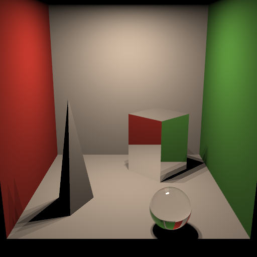
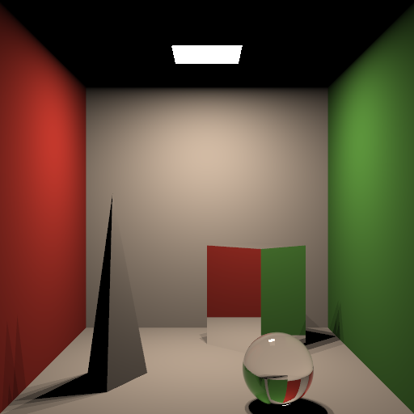

# 实验三：使用、人工验收与报告说明

## 1. 独立场景：最小材质改动

本实验使用 `resource/ray_tracing_lab3.scn`，从当前 `path_tracing_cornel.scn` 复制得到。参考文件逐字节保持不变。保留原来的球、长方体、金字塔、五面墙和顶部面光源；不重建形状、不改动位置、尺寸、顶点、法线和光源参数。

| 原模型 | 本实验材质 | 原模型位置（保持不变） |
| --- | --- | --- |
| Sphere | 透明玻璃 Glass，Type=2，ior=1.5，absorbed=(1,1,1) | (-100,-228,800)，半径 50 |
| Box | 理想镜面 Mirror，Type=3，reflect=(0.94,0.94,0.94) | (-100,-178,1150)，原 6 个有限平面 |
| Pyramid | 原 White 漫反射，默认 Type=0 | (150,-78,900)，原 4 个三角形 |

相对参考文件只新增 Glass、Mirror 两个材质定义，将球的材质绑定改为 Glass，将长方体 6 个面的绑定改为 Mirror；金字塔与墙面继续使用原材质。另仅在副本中将红色 RGB 参数 `0.63 0.065, 0.05` 中多余的逗号去除，避免导入器数值解析失败，不修改颜色意图。没有新增环境补光、填充灯、条纹或其他几何体。

合计 16 个几何图元：5 面墙＋1 个球＋6 个长方体面＋4 个金字塔面。矩形发光面单独求交，不计入 KD-Tree 图元数。保留原有物体与地面的接触关系，不再添加地面间隙或倾转几何体。

顶部面光源保持 IRV=(47.8384,38.5664,31.0808)，P=(60,275,1088)，U=(-120,0,0)，V=(0,0,-120)。渲染器用固定 2×2 中点分层采样计算直接光照和近似软阴影，镜面与玻璃射线也能看到发光面。四点平均近似同一面积光照积分，采样数降低会使软阴影边缘更粗略，但不会改变光源几何、光能或材质。发光面几何与有限平面逆基向量在渲染器初始化时预计算，避免每条光线重复构造和求逆。

## 2. 构建与启动

在项目根目录的 PowerShell 中执行：

```powershell
.\tools\build_ray_tracing.ps1 -WithChecks
Push-Location .\code\out\build\ray-tracing-release
.\NRenderer.exe
Pop-Location
```

需要 Visual Studio C++ 桌面开发工具和 CMake。可添加 `-Clean` 干净重建。工作目录必须是 exe 所在目录，框架从 `./components/*.dll` 加载插件；更新 DLL 后重启旧程序。

在 Asset 中导入 `resource/ray_tracing_lab3.scn`；切换场景建议重新启动，避免重复导入叠加。选择 RayTracingBruteForce 或 RayTracingKDTree。原 SimplePathTracing 插件只支持漫反射，不用于本场景的镜面和玻璃验收。

| 设置 | 首次预览 | 最终截图 |
| --- | --- | --- |
| Width / Height | 256 / 256 | 512 / 512 |
| Sample Nums | 1 | 4 或 16 |
| Depth | 6 | 8 |
| Ambient | Constant，RGB=(0,0,0) | 相同 |
| Camera Position | (0,165,100) | 相同 |
| Up / LookAt | (0,1,0) / (0,-100,1050) | 相同 |
| Fov / Aspect / Aperture | 43 / 1 / 0 | 相同 |

导入场景不会自动修改相机。默认仍为 Position=(0,0,-3)、LookAt=(0,0,0)、Fov=40。性能测量使用默认相机，推荐截图使用上表抬高视点，两者数据不混用。





## 3. 人工验收

1. 前方球体为透明玻璃：可见折射后的墙面和物体，边缘存在反射。可临时将独立场景的 ior 改为 1 作直通对照，验收后恢复 1.5。
2. 后方长方体为镜面：六个面共享 Mirror 材质，显示墙面或其他物体的反射影像。顶面仍保持原朝向，没有为突出顶面而倾转几何体。
3. 金字塔保留白色漫反射，依据原灯光产生各面的明暗和阴影；无环境填充时背光面接近黑色是当前直接光照模型的预期。
4. 固定其他参数比较 Depth=0/2/6/8：0 时球和镜面停止递归；较高深度恢复反射/折射。
5. 两后端使用相同场景、相机和参数，边缘、反射、折射、阴影应一致，重复渲染不能移动物体。
6. 默认相机和原参考场景一致；上表的抬高视点只用于可选验图，不写入场景。墙面连续，无额外条纹和测试板。软阴影由 4 个灯面样本近似，近看可能存在采样分层。

本实现仍为 Whitted 风格：无漫反射间接光照、颜色渗透和焦散；玻璃阴影按遮挡体处理，不模拟透光焦散。本场景未设置 ambientColor，界面 Ambient 保持 0 时没有额外经验补光。

## 4. 性能与正确性测量

```powershell
.\tools\run_lab3_benchmark.ps1 -Size 128 -Samples 1 -Depth 6 -Repeat 5
```

默认只测新场景，不会生成场景文件。脚本先运行回归检查，分别预热、交替测量两个后端；正式时间关闭热循环计数，另外单独运行一次诊断。每次创建新渲染器和 KD-Tree，取完整执行时间中位数。计时包含准备、建树、追踪、像素交付和局部资源释放，不包含导入、文件输出、图像比较和人工等待。测量前后核对 SHA256，输入变化时中止。界面正常执行仍仅输出一条总时间。

固定 2×2 灯面采样意味着每个受光点最多执行 4 次阴影查询，相比先前 4×4 采样减少 75% 的灯光可见性查询；这是面积光源积分的确定性低阶近似，代价是阴影边缘平滑度下降。16 个图元的小场景中，KD-Tree 仍可能因额外节点和包围盒遍历而慢于暴力遍历，应如实报告。已删除旧性能场景，它们的大规模加速倍数不再作为当前场景的结论。

结果保存在 `code/out/lab3-results/`，当前交付快照在 `doc/lab3-results/`：summary.csv 保存中位数和场景哈希；ray_tracing_lab3.csv 保存 5 次、共 10 行正式时间；ray_tracing_lab3-diagnostics.csv 保存单次两后端计数；showcase-camera-validation.csv 与 showcase-default-validation.csv 保存两视点验图结果。

在项目根目录导出截图：

```powershell
Push-Location .\code\out\build\ray-tracing-release
.\RayTracingCheck.exe --scene ..\..\..\..\resource\ray_tracing_lab3.scn --output ..\..\lab3-showcase --size 512 --samples 4 --depth 8 --repeat 1 --showcase-camera
Pop-Location
```

去掉 `--showcase-camera` 使用默认相机；CSV 用 camera_preset 区分视点。需要计数时添加 `--diagnostics`，不要用其耗时填正式性能表。

### 当前场景实测（2026-11-20）

Windows / MSVC Release / 单渲染线程；默认相机，128×128、1 sample、Depth=6；预热后各 5 次中位数。

| 几何图元 | 暴力总时间 ms | KD 总时间 ms | 时间比 | 最大像素差 |
| ---: | ---: | ---: | ---: | ---: |
| 16 | 33.854 | 33.682 | 1.01× | 0 |

诊断运行的阴影射线由 273,360 降至 68,340，恰好减少 75%；两后端图像仍逐像素一致。当前初始化还缓存灯面采样位置和固定面积权重，避免每个受光点重复计算；这项改动同时用于两个后端，不能仅凭跨批次计时确定其加速幅度。小场景的 KD-Tree 收益不稳定，不应宣称普遍加速。此前两个视点的 512×512、4 samples、Depth=8 图像已逐像素对照；当前版本的回归和采样数复查见 [优化分析](lab3-kdtree-optimization-analysis.md)。

默认界面参数 500×500、16 samples、Depth=4 的单次量级对照：4×4 灯光采样的旧设置为暴力/KD-Tree 24.685/23.111 秒；本次 2×2 采样并缓存灯面求交数据后为 5.718/6.906 秒。运行批次的系统负载不同，数字只作体验参考；此设置下暴力约快 4.3 倍，KD-Tree 约快 3.3 倍。该小场景没有保证 KD-Tree 更快的空间，正式性能结论仍使用上表同批次 5 次中位数。

场景 SHA256：`03346274bd5c014891f3be09348d9fa71d66c0572401e5dc1af4dfff9b13ad84`。

几何一致性检查：撤销新增材质、7 处材质绑定和副本 RGB 标点修正后，与参考文件完全一致。

## 5. 报告与代码

报告应说明参考场景、三类材质和封闭几何、最近交点与阴影查询、递归反射/折射/全反射、KD-Tree 划分和遍历；展示相同参数下的后端图像一致性与时间中位数，讨论小场景限制及灯面采样、递归深度对时间的影响。使用与截图或性能 CSV 对应的场景哈希，避免混用不同场景数据。

`Adapter.cpp` 接入插件；`RayTracer.cpp` 处理递归和灯光；`SceneGeometry.cpp` 与 `Intersections.cpp` 准备和求交；`KDTree.cpp` 构建与遍历；`tools/RayTracingCheck.cpp` 是唯一保留的回归/测量工具，覆盖 8000 组最近命中与遮挡查询、光学、几何、DLL、重复渲染及当前场景。旧 lab3-*-plan.md 为历史方案，以本说明和当前代码为准。
